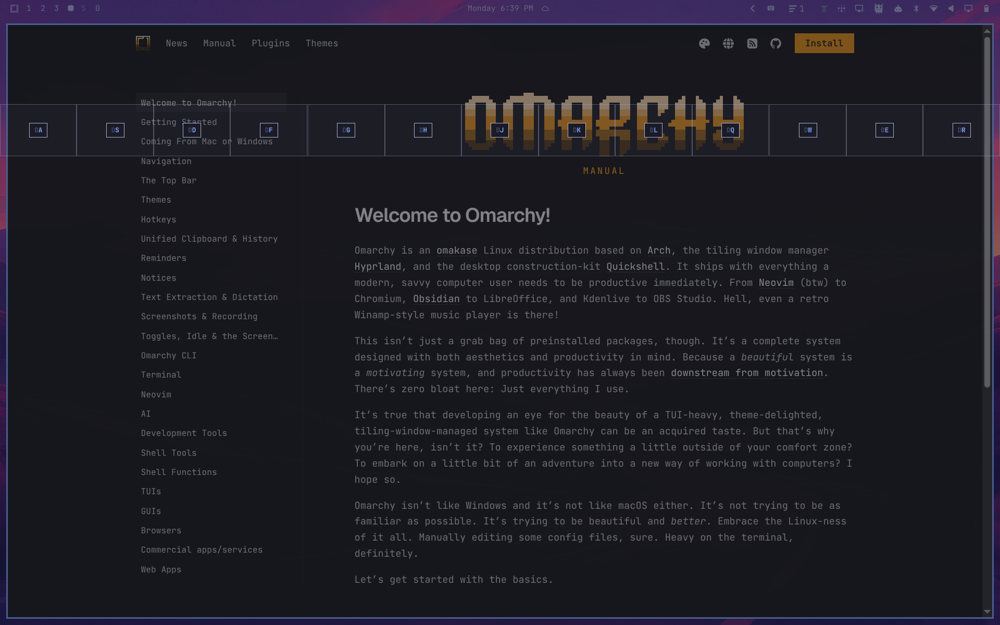
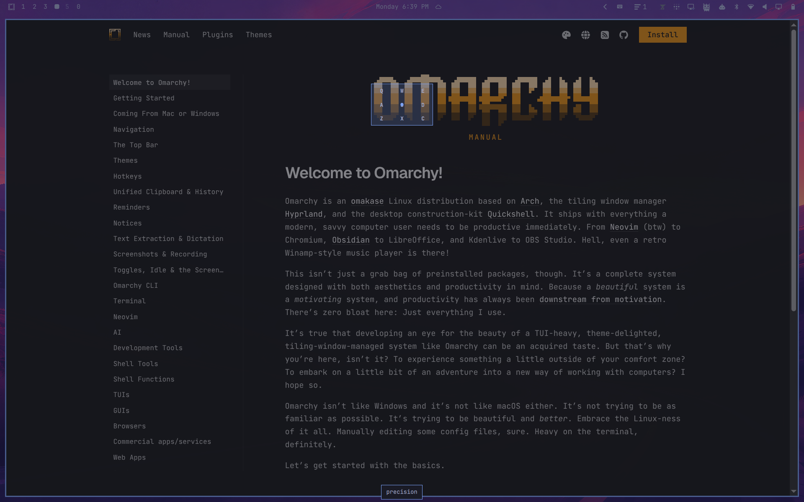
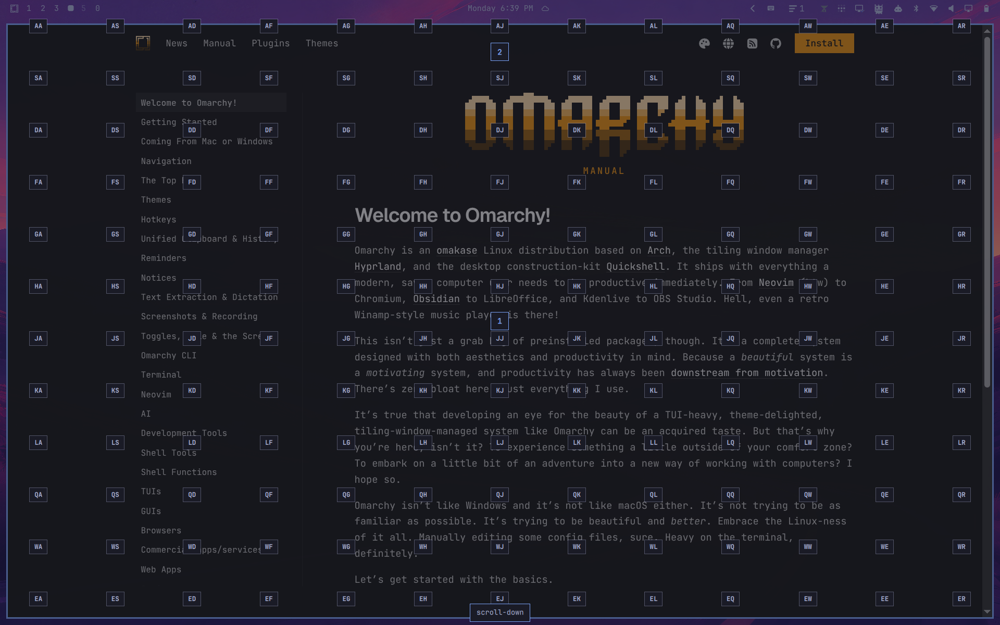

# Omatap

Keyboard-driven clicking for Omarchy: every spot on the screen gets a 2-letter hint, every window a number.


## Requirements

- Omarchy Quattro (Hyprland + omarchy-shell)
- `python` and `python-evdev`
- Write access to `/dev/uinput` (granted to the logged-in seat user by default; otherwise add an udev rule or join the `input` group)

## Install

```bash
omarchy plugin add https://github.com/gothe92/omatap --enable
```

Bind it in `~/.config/hypr/bindings.lua` (`code:47` is the key right of `L`: `;` on US, `É` on Hungarian):

```lua
o.bind("SUPER + code:47", "Omatap", "omarchy-shell shell toggle gothe92.omatap '{}'")
```

## Update

```bash
omarchy plugin update gothe92.omatap
omarchy-restart-shell
```

The overlay stays loaded, so the shell restart is needed for the new version to take effect.

## Remove

```bash
omarchy plugin remove gothe92.omatap
rm -rf ~/.local/state/omatap
```

Delete the `Omatap` line from `~/.config/hypr/bindings.lua`. The background click daemon exits on its own after 10 idle minutes.

## Keys

| Key | Action |
|-----|--------|
| `A`–`Z` ×2 | Click grid cell |
| `Shift` + 2nd letter | Open 3×3 sub-grid |
| `1`–`9` | Click window |
| `Tab` | Toggle sub-grid mode |
| `QWE` `ASD` `ZXC` / arrows + `Enter` | Pick point in sub-grid |
| `;` `'` `,` `.` | Right / double / middle click / move only |
| `[` `]` | Scroll up / down |
| `Backspace` | Clear prefix |
| `Esc` | Back / close |

Punctuation keys are matched by position, so on Hungarian layout they are `É` `Á` `,` `.` and `Ő` `Ú`.

The click daemon exits after 10 minutes idle; errors are logged to `~/.local/state/omatap/daemon.log`.

## Screenshots

| | |
|---|---|
|  Grid and window targets |  First letter typed |
|  Precision sub-grid |  Right click mode |
|  Double click mode |  Middle click mode |
|  Move only mode |  Scroll mode |
